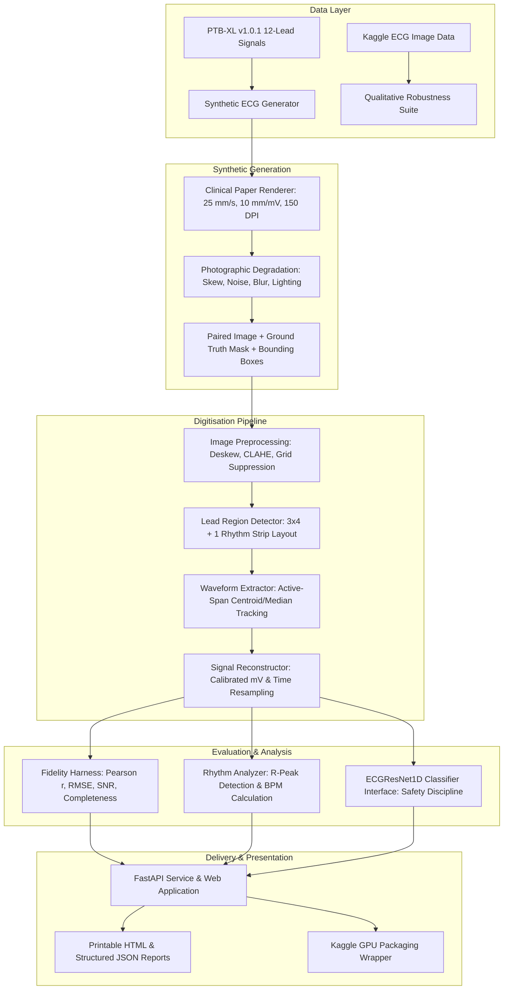

# ECG DigiAI — System Architecture & Implementation Design

**Institution:** Jaypee Institute of Information Technology, Noida  
**Department:** Electronics & Communication Engineering  
**Project:** ECG Digitisation & Analysis Using AI (ECG DigiAI)

---

## 1. High-Level Architecture Overview

---

## 2. Core Subsystems

### A. Synthetic Generation Subsystem (`ecg_digitization.synthetic`)
- **Grid Layout**: 1 mm minor pink grid lines (`#FFD7D7`), 5 mm major pink grid lines (`#EB8C8C`).
- **Physical Scale**: $25\text{ mm/s}$ horizontal speed ($147.64\text{ px/s}$ at $150\text{ DPI}$), $10\text{ mm/mV}$ vertical gain ($59.06\text{ px/mV}$).
- **Standard 12-Lead Geometry**:
  - Column 0 ($0.0 - 2.5\text{ s}$): Leads I, II, III.
  - Column 1 ($2.5 - 5.0\text{ s}$): Leads aVR, aVL, aVF.
  - Column 2 ($5.0 - 7.5\text{ s}$): Leads V1, V2, V3.
  - Column 3 ($7.5 - 10.0\text{ s}$): Leads V4, V5, V6.
  - Bottom Strip ($0.0 - 10.0\text{ s}$): Continuous Lead II rhythm strip.
- **Trace Mask**: Dedicated single-channel binary ground-truth mask ($255 = \text{trace}, 0 = \text{background}$) for exact spatial segmentation evaluation.

### B. Image Preprocessing Subsystem (`ecg_digitization.preprocessing`)
1. **Grayscale & Contrast**: CLAHE equalizes local contrast across uneven lighting gradients.
2. **Deskewing**: Hough line transform detects horizontal lead dividers and page borders, computing median tilt angle $\theta$ and performing affine correction.
3. **Colored Grid Suppression**:
   - Red-channel isolation: Paper grid lines reflect light in the red spectrum ($R \approx 255$), minimizing grid contrast.
   - HSV color gating: Pixels with saturation $S > 25$ and value $V > 100$ are masked to white ($255$).
4. **Trace Binarization**: Dual-threshold approach combining adaptive Gaussian local thresholding with Otsu global thresholding, followed by morphological opening.

### C. Waveform Extraction & Reconstruction Subsystem (`ecg_digitization.reconstruction`)
1. **Active Trace Span Bounding**: Determines the start ($x_{\min}$) and end ($x_{\max}$) columns containing active foreground trace pixels within each lead crop, preventing margin dilation errors.
2. **Column-wise Tracking**: Computes median / weighted intensity centroid for each column.
3. **Linear Gap Filling**: Interpolates missing columns caused by pen fades or faint pixels.
4. **Isoelectric Baseline Subtraction**: Baseline $y_{\text{base}}$ corresponds to the median of the signal; physical voltage is $V = (y_{\text{base}} - y) / \text{pixels\_per\_mv}$.
5. **Resampling**: Uses 1D spline interpolation to output uniform time series at target sampling rate ($100\text{ Hz}$).

### D. Rhythm Analysis & Model Safety Subsystem (`ecg_digitization.inference`)
1. **R-Peak Detector**: 2nd order Butterworth bandpass filter (0.5–40 Hz), 1st difference squaring, moving window integration ($120\text{ ms}$), and adaptive thresholding ($0.35 \times 90\text{th percentile}$).
2. **Rule-Based Clinical Logic**:
   - Sinus Bradycardia: $\text{HR} < 60\text{ bpm}$.
   - Normal Sinus Rate: $60 \le \text{HR} \le 100\text{ bpm}$.
   - Sinus Tachycardia: $\text{HR} > 100\text{ bpm}$.
3. **Model Discipline**:
   - Multi-label residual 1D CNN baseline (`ECGResNet1D`).
   - If trained weights are not loaded: returns `model_not_trained` (no fake predictions).
   - If target has sparse direct labels (e.g. `STE_`): returns `Not supported by available labels`.
   - Clinical risk level is strictly reported as `Not assessed`.

### E. Deep Learning Digitisation Subsystem (`ecg_digitization.models.digitizer_unet`)
1. **Architecture (`ECGDigitizerUNet`)**:
   - 2D ResNet-U-Net encoder-decoder featuring residual convolutional blocks (`ConvBlock2D`) with skip connections.
   - Trace Segmentation Head: $1\times 1$ conv generating pixel-level trace logits and probabilities $\hat{M} \in [0, 1]^{H \times W}$.
   - Differentiable Soft-Argmax Waveform Extraction:
     $$\hat{y}(x) = \sum_{y=0}^{H-1} y \cdot \text{softmax}_y\left(\frac{\text{logits}(y, x)}{\tau}\right)$$
   - Physical Calibration & Baseline Mapping:
     $$\hat{V}(x) = \frac{y_{\text{base}} - \hat{y}(x)}{\text{pixels\_per\_mv}}$$
   - Column Confidence & Missing Trace Handling: Computes column-wise maximum probability $\max_y \hat{M}(y, x)$ to mask occluded/missing traces.
2. **Multi-Task Composite Loss (`DigitizerReconstructionLoss`)**:
   $$\mathcal{L} = \mathcal{L}_{\text{BCE}} + \mathcal{L}_{\text{Dice}} + 2 \cdot \mathcal{L}_{\text{SmoothL1}}(\hat{V}, V) + 1.0 \cdot (1 - r(\hat{V}, V))$$
3. **Leakage-Safe Dataset Splitting (`ecg_digitization.data.split_manager`)**:
   - Enforces official PTB-XL patient-disjoint folds (Folds 1-8 Train, 9 Val, 10 Test).
   - Parent record identifier extraction preserves patient integrity across all synthetic augmentations and crops.

