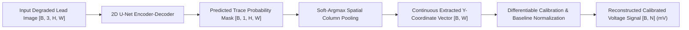

# ECG DigiAI — Implementation Roadmap & Technical Strategy Review

**Institution:** Jaypee Institute of Information Technology, Noida  
**Department:** Electronics & Communication Engineering  
**Project:** Final-Year B.Tech Major Project — ECG Digitisation & Analysis Using AI  
**Focus:** Primary Objective Realignment — Image-to-Signal Digitisation  

---

## 1. Project Primary Objective vs Auxiliary Modules

### Primary Objective (Component B)
**ECG Image-to-Signal Digitisation**: Developing an automated, robust computer vision and deep-learning pipeline that takes scanned or photographed paper ECG images (under real-world skew, background noise, colored grids, and illumination variations) and reconstructs calibrated, multi-lead digital 1D time-series signals ($mV$ vs time).

### Auxiliary Objective (Component C)
**AI-Based ECG Analysis**: Downstream clinical rhythm assessment (heart rate, R-peaks, Sinus Bradycardia, Sinus Tachycardia) and multi-label pathology classification on the *reconstructed digital signals*.

### Analysis of Current `ECGResNet1D` Model
- The current `ECGResNet1D` baseline accepts $12 \times N$ numerical signals as input and predicts 7 pathology labels.
- While required for Component C of the academic scope, training this model in isolation **does not train or advance the core image digitisation pipeline**.
- **Strategic Recommendation**:
  1. Retain `ECGResNet1D` as an auxiliary downstream module.
  2. Reallocate the primary remote Kaggle GPU training budget to an **Image-to-Waveform Digitisation Network (`ECGDigitizerUNet`)**.

---

## 2. Dataset Pairing Audit

| Dataset | Local Archive | Total Records | Ground Truth Signals? | Paper Images? | Direct Pairing? |
|---|---|---|---|---|---|
| **PTB-XL v1.0.1** | `data/raw/ptb-xl/ptb-xl-dataset.zip` (~1.76 GB) | 21,837 WFDB records | **Yes** (12 leads, 100 Hz / 500 Hz) | **No** (pure digital) | **No** |
| **ECG Image Data** | `data/raw/ecg-image-data/ecg-image-data.zip` (~858 MB) | 123,998 PNG images | **No** (unpaired image crops) | **Yes** (single-beat crops) | **No** |

**Conclusion**: There are **zero paired image-signal records** between the two downloaded raw archives. Attempting to train supervised image-to-signal networks directly on `ecg-image-data` is mathematically and scientifically infeasible because no ground-truth waveform vectors exist for those images.

---

## 3. Ground-Truth Strategy: Synthetic ECG Image Generation

To enable rigorous supervised deep learning for digitisation, the project leverages synthetic paper rendering directly from authentic clinical signals:

1. **Source Signals**: Authentic 12-lead digital signals drawn from PTB-XL (Folds 1–8 Train, Fold 9 Val, Fold 10 Test).
2. **Clinical Grid Simulation**: Standard 1 mm minor pink grid lines and 5 mm major red grid lines adhering to clinical standards ($25\text{ mm/s}$ paper speed, $10\text{ mm/mV}$ voltage calibration, $150\text{ DPI}$).
3. **Realistic Degradation Pipeline**:
   - Affine rotation skew ($\pm 5^\circ$).
   - Perspective camera warp (simulating smartphone photographs).
   - Non-uniform lighting and shadow gradients.
   - Optical Gaussian blur ($3\times 3$, $5\times 5$).
   - Additive Gaussian sensor noise.
4. **Exact Paired Ground Truth**:
   - Target 1D digital signal: $s(t) \in \mathbb{R}^{12 \times 1000}$.
   - Target 2D binary trace segmentation mask: $M(x, y) \in \{0, 1\}^{H \times W}$.
   - Target lead bounding boxes: coordinates $(x_1, y_1, x_2, y_2)$ for each lead window.

---

## 4. Proposed Image-to-Waveform Model Architecture: `ECGDigitizerUNet`

The optimal deep learning architecture for image-to-signal digitisation combines deep semantic trace segmentation with a differentiable coordinate extraction layer:

### Architecture Specifications
1. **Backbone**: 2D U-Net with ResNet18/MobileNet encoder blocks for efficient GPU convergence.
2. **Segmentation Head**: Outputs pixel-wise trace probability $\hat{M}(x, y)$.
3. **Differentiable Soft-Argmax**:
   For each image column $x \in [0, W-1]$, the vertical trace position is computed as:
   $$\hat{y}(x) = \sum_{y=0}^{H-1} y \cdot \text{softmax}_y\left(\frac{\hat{M}(x, y)}{\tau}\right)$$
   Where $\tau$ is a temperature hyperparameter. This allows backpropagating gradients directly from 1D waveform losses into the 2D feature extractor!
4. **Loss Function**:
   $$\mathcal{L} = \mathcal{L}_{\text{BCE}}(\hat{M}, M) + \mathcal{L}_{\text{Dice}}(\hat{M}, M) + \alpha \cdot \text{SmoothL1}(\hat{s}, s) + \beta \cdot (1 - \text{PearsonCorrelation}(\hat{s}, s))$$

---

## 5. Waveform Reconstruction Evaluation Metrics

Rather than classification accuracy or F1 score, model evaluation tracks:

1. **Pearson Correlation Coefficient ($r$)**: Measures morphological and phase synchronization against ground-truth signal waveforms (target: $r > 0.90$).
2. **Root Mean Squared Error (RMSE in mV)**: Measures absolute calibration and amplitude fidelity (target: $\text{RMSE} < 0.25\text{ mV}$).
3. **Signal-to-Noise Ratio (SNR in dB)**: Measures residual background extraction artifacts ($10 \log_{10} \frac{\|s\|^2}{\|s - \hat{s}\|^2}$).
4. **Segmentation Intersection-over-Union (IoU / Dice)**: Measures pixel-level trace isolation accuracy independent of calibration.
5. **Trace Completeness (%)**: Percentage of continuous signal successfully recovered without dropout.

---

## 6. Execution Roadmap & Next Steps

1. **Step 1: Implement `ECGDigitizerUNet` Module**
   - Add U-Net segmentation and soft-argmax waveform extraction model in `src/ecg_digitization/models/digitizer_unet.py`.
   - Add unit tests verifying forward pass on image batches and loss calculation.
2. **Step 2: Package Digitisation Kaggle Training Bundle**
   - Replace the classification-only script with a GPU training script (`train_digitizer_kaggle.py`) that generates synthetic degraded lead crops on-the-fly from PTB-XL WFDB records and trains `ECGDigitizerUNet`.
   - Package `kernel-metadata.json` with attached `khyeh0719/ptb-xl-dataset`.
3. **Step 3: Job Card & User Authorization**
   - Present the new Digitisation GPU Job Card (expected training time, quota usage, model architecture).
   - Await explicit user authorization before execution.
4. **Step 4: Autonomous Submission, Monitoring & Checkpoint Registration**
   - Submit job via Kaggle CLI, poll status, download `ecg_digitizer_unet.pt`, and integrate into `ECGDigitizerPipeline`.
